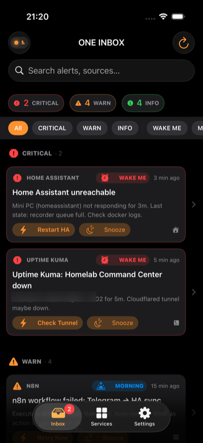

# One Inbox

> **Built for my own use. Not distributed.**

One iPhone feed for all the alerts my home systems send: Home Assistant, uptime monitoring, automation workflows,
containers and background services. Instead of five apps buzzing, a small server on my Mac mini collects
everything, and an AI step sorts each alert into **Wake me**, **Morning** or **Low**.

<p align="center">
  
</p>

<sub>Demo mode with sample data.</sub>

## How it fits together

```
Home Assistant · Uptime Kuma · n8n · Docker · launchd …
                 │
                 ▼
   aggregator (FastAPI, on my Mac mini)  ──  AI triage
                 │
                 ▼
          One Inbox (SwiftUI, iPhone)
```

## About

A spare-time project, built mostly with AI coding agents. This repository is a showcase; the code is private
because it is wired to my own home setup.

Made by [Sepehr](https://sepehr.digital).
